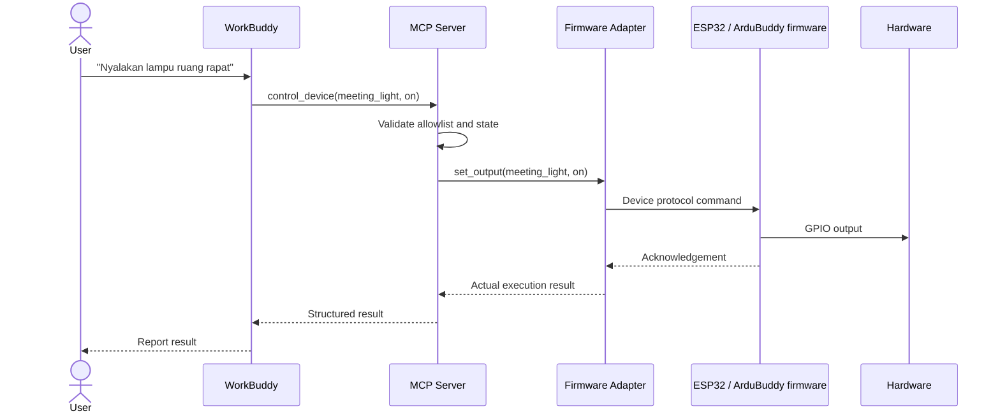

# Architecture — ArduBuddy

## Komponen

### WorkBuddy
Antarmuka pengguna dan agen yang memahami instruksi, memilih MCP tools, lalu merangkai respons. Dukungan connector, transport, dan konfigurasi perlu diverifikasi pada versi WorkBuddy yang dipakai.

### MCP Server
Mengekspos tool dengan schema ketat. Bertanggung jawab atas validasi input, allowlist perangkat, pemanggilan adapter, timeout, logging, dan hasil terstruktur. Berjalan sebagai `ArduBuddy.exe --serve` dengan transport **stdio** ke WorkBuddy; opsi HTTP tersedia untuk debugging. Semua log ke file + stderr, tidak pernah ke stdout.

### Firmware Adapter
Mengisolasi detail protokol firmware. Adapter dapat menggunakan HTTP, MQTT, serial, atau protokol lain sesuai interface firmware.

### ESP32 / ArduBuddy firmware
Runtime perangkat untuk menjalankan aksi GPIO dan pembacaan sensor sesuai kemampuan firmware.

## Sequence diagram

## Prinsip desain
1. Jangan biarkan LLM memilih GPIO arbitrer.
2. Gunakan nama perangkat logis, bukan pin bebas.
3. Pisahkan definisi scene dari kode MCP.
4. Jangan menyatakan sukses tanpa acknowledgement.
5. Semua operasi memiliki timeout.
6. Simpan secret di environment variable.
7. Gunakan mock adapter untuk pengujian.

## Transport yang dipilih

| Segmen | Transport | Alasan |
|---|---|---|
| WorkBuddy ↔ MCP Server | **stdio** | Sesuai custom connector `mcp.json`; exe diluncurkan sebagai subprocess dengan `args: ["--serve"]` |
| MCP Server ↔ ESP32 | **HTTP** | ArduBuddy v1.0 sudah menyediakan `/api/status`, `/api/skill/execute`, `/api/skill/chain` |
| Browser ↔ ESP32 (flashing) | **Web Serial** | `website/flash.html`, memakai esptool-js; butuh HTTPS/localhost |

MQTT memang tersedia di firmware, tetapi untuk MVP cukup memakai HTTP langsung:
lebih sedikit komponen (tidak perlu broker) dan acknowledgement per perintah
sudah tersedia. Serial dipakai hanya saat flashing dan konfigurasi WiFi.

**Distribusi:** installer GUI pada exe yang sama menulis
`%APPDATA%\ArduBuddy\config.json` dan melakukan *merge* pada
`~\.workbuddy-ai\mcp.json` (dengan backup), lalu pengguna melakukan Trust di UI WorkBuddy.
Lihat [CONNECTOR-INSTALL.md](CONNECTOR-INSTALL.md).
